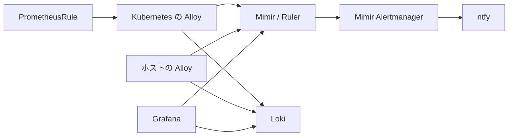

# 監視基盤の運用


日常確認は [PKE / Overview](https://grafana.str08.net/d/pke-overview) を入口にし、要確認・未確認の分野から詳細画面へ進む。
収集・評価・通知経路は [Monitoring Pipeline](https://grafana.str08.net/d/pke-monitoring-pipeline) で確認する。
ntfyの共通ルール通知はGrafanaの対象パネルとRunbookへのリンクを含む。表示の読み方と制約は [ダッシュボード運用](grafana/README.md#overviewと調査リンク) を参照する。
両クラスタとホストのメトリクス・ログを、natsume の Mimir / Loki に集約する。
アラートは Mimir Ruler が評価し、同じ Mimir の Alertmanager から ntfy へ送る。
本番では合成通知や障害注入を行わず、設定・収集・評価・ラベルを確認する。

## 構成と設定の場所



| 対象 | 設定 |
|---|---|
| Kubernetes の収集・ルール同期 | [natsume Alloy](flux/clusters/natsume/apps/alloy/alloy-config.yaml)、[meruto Alloy](flux/clusters/meruto/apps/alloy/alloy-config.yaml) |
| ホストの収集 | [install-alloy role](ansible/roles/install-alloy/)、[host_vars](ansible/inventories/host_vars/) |
| Grafanaダッシュボード | [Git管理・検証・移行手順](grafana/README.md) |
| Mimir / Ruler / Alertmanager | [Mimir HelmRelease](flux/clusters/natsume/apps/mimir/helmrelease-mimir.yaml) |
| 共通アラート | [monitoring-rules chart](charts/monitoring-rules/README.md)、各クラスタの `apps/monitoring-rules/` |
| アプリ固有のアラート・収集 | 各アプリの PrometheusRule / ServiceMonitor / PodMonitor / Probe |
| 通知経路と抑制 | natsume Alloy の `mimir.alerts.kubernetes.global_config` |
| ntfy の表示・認証・ACL | [ntfy HelmRelease](flux/clusters/natsume/apps/ntfy/helmrelease-ntfy.yaml) |

ホストと meruto は mTLS で `https://mimir.pstr.space/api/v1/push` と `https://loki.pstr.space/loki/api/v1/push` に送信する。
meruto の Vector も syslog を Loki に送る。
CCAT-1 のSNMP収集・syslog送信・community登録は [CCAT-1 の監視](flux/clusters/meruto/apps/ccat-snmp-exporter/README.md) を参照する。
Mimir は単一 tenant `anonymous` を使い、Ruler の通知先は `http://mimir.mimir:8080/alertmanager`。
通知先は ntfy のみで、外部 heartbeat 監視はない。natsume / Mimir 全断時の通知はこの構成ではできない。

## ラベルとルールの管理

| ラベル | 意味 |
|---|---|
| `cluster` | Kubernetes は `natsume` / `meruto`。ホストは inventory の `cluster` に従う |
| `cnpg_cluster` | CNPG の DB 名。例: `misskey-cluster-restored` |
| `hostname` | ホストの Alloy が収集するノード名 |
| `job` | 収集対象。Alloy 自己監視は Kubernetes が `alloy`、ホストが `alloy-host` |

Kubernetes Alloy は全メトリクスを共通 relabel に通す。
CNPG の元の DB ラベルを `cnpg_cluster` に保持したうえで、`cluster` を収集元で上書きする。
DB PodMonitor も Pod の `cnpg.io/cluster` から `cnpg_cluster` を付ける。
DB 単位の検索・集計・join に `cluster` を流用しない。

各 Alloy は自クラスタの PrometheusRule を同期する。
Mimir の保存先は `natsume/<namespace>/<resource>/<uid>` または `meruto/<namespace>/<resource>/<uid>`。
`extra_query_matchers` が入力を自クラスタに限定し、`external_labels` が評価結果にも同じ `cluster` を付ける。
複数クラスタを横断する式はこの同期対象に入れない。
meruto が停止しても、同期済みルールは natsume の Ruler で評価され続ける。

共通ルールの閾値・待機時間・調査手順は [chart README](charts/monitoring-rules/README.md) を参照する。
クラスタ別の hosts / units / networkDevices と databases は、Ansible inventory・netplan と CNPG manifest から `python3 scripts/sync-monitoring-inventory.py` で生成する。
HelmRelease の生成ブロックは直接編集しない。CI の `--check` で生成漏れを検出する。
欠測や DB の運用ポリシーは期待値の recording metrics と照合し、アラート式に対象名を列挙しない。
Probe も `applications` から期待値を生成し、結果系列の消失を `ProbeMetricsAbsent` で監視する。
meruto の CNPG DB グループは無効にする。

## ntfy の通知と認証

通知先は `https://ntfy.pstr.space`。
購読には ntfy の認証済みユーザーを使い、Alertmanager 用ユーザーは送信専用にする。

| 条件 | topic | priority | tags | 再通知 |
|---|---|---|---|---|
| natsume / meruto、critical | `<cluster>-alerts` | 5 | `rotating_light` | 1時間 |
| natsume / meruto、warning | `<cluster>-alerts` | 3 | `warning` | 12時間 |
| natsume / meruto、その他・severity 欠落 | `<cluster>-alerts` | 2 | `information_source` | 12時間 |
| cluster 不明・欠落 | `pke-alerts` | severity に従う | severity に従う | severity に従う |
| resolved | 発火時と同じ | 2 | 発火時と同じ | `send_resolved=true` |

grouping は `cluster / alertname / namespace / severity`、初回待機は30秒、同一グループの更新間隔は5分。
タイトルは `Firing: <cluster> / <alertname>` または `Resolved: <cluster> / <alertname>` とする。
アイコンは tags に統一し、タイトルに絵文字を加えない。
priority と本文は ntfy のカスタム `alertmanager` template で設定する。

抑制は、同じ対象の critical → warning（PVC・ホスト filesystem・Longhorn node / disk・証明書期限）と、`http-get` の EndpointDown → HTTPStatusCodeError に限定する。
対象を識別するラベルは双方に必要で、欠落同士を一致させない。
ホスト停止や欠測だけを理由に、Pod・PVC の通知をまとめて抑制しない。

### 認証情報を設定・更新する

1Password の Kubernetes vault に次の item / field を置く。

| Item / field | 内容と同期先 |
|---|---|
| `ntfy-admin.auth-users` | `user:password-hash:role` のカンマ区切り。`ntfy/ntfy-admin` へ同期 |
| `ntfy-admin.auth-tokens` | `user:token` のカンマ区切り。同じ Secret へ同期 |
| `ntfy-alertmanager.token` | publish token 単体。`alloy/ntfy-alertmanager` へ同期 |

既存 admin と他のユーザー・token を保持する。
`alertmanager` は role `user` とし、`natsume-alerts`、`meruto-alerts`、`pke-alerts` の write-only ACL を与える。
anonymous は deny-all。Alloy には admin の認証情報を渡さない。
パスワード hash と token は ntfy CLI で生成し、値は直接 1Password に保存する。

通常の token rotation は次の順序で行う。

1. `ntfy-admin.auth-tokens` に新 token を追加し、旧 token と併存させる。
2. Secret の更新と ntfy Deployment の再起動を確認する。自動再起動が起きなければ rollout restart する。
3. `ntfy-alertmanager.token` を新 token に置き換える。
4. Alloy の Secret 再取得、Mimir への設定保存と有効設定の更新を確認する。
5. 設定反映と認証エラーの有無を確認してから、旧 token だけを外す。漏洩時は失効を優先する。

Alloy は Secret を1分ごとに取得し、再起動なしで再評価する。
Mimir Alertmanager が保存済み設定を取り込む間隔は5分なので、保存成功と有効設定への反映には時間差がある。
通常の取得待ちを同期失敗と判断して Alloy を再起動しない。
ntfy は単一 Pod / Recreate のため、再起動中は配信先が一時停止する。
通知履歴・ユーザー・ACL・token は CNPG の `ntfy-cluster` に保存する。
DB 接続には CNPG が生成する `ntfy-cluster-app` Secret の `uri` を使い、ユーザー・token は引き続き 1Password から宣言する。
添付ファイルは Longhorn の `ntfy` PVC に保存し、DB のバックアップには含まれない。
DB の構成・バックアップ操作は [CNPG.md](CNPG.md) を参照する。

SQLite からの切り替えは新規 DB への接続として行い、既存の通知履歴は取り込まない。
1Password に宣言していないユーザー・token・ユーザー設定は再登録が必要となる。
`cache-file` / `auth-file` / `web-push-file` と `NTFY_DATABASE_URL` は併用しない。
切り替え後は旧 SQLite ファイルを参照しない。添付ファイルも DB に対応する通知がないものは ntfy が削除する。

## 変更を検証して反映する

リポジトリのルートで実行する。
Python 3、PyYAML、Jinja2、Helm、Docker、kubectl が必要。

```sh
python3 scripts/validate-monitoring-rules.py
python3 scripts/validate-ntfy-alerts.py
python3 scripts/validate-cluster-labels.py
```

ルールは render・inventory 照合・実 Alloy による式の変換・promtool の時系列テストで検証する。
通知はローカルの Alertmanager / ntfy で経路、抑制、firing / resolved、priority、tags、ACL、token rotation を検証する。
ラベル検証は両クラスタとホストの設定を描画し、ローカル送信で値を照合する。
本番 Secret や本番へのテスト通知は使わない。

### Kubernetes の設定

マージ後は Flux の通常同期を使い、変更した Kustomization / HelmRelease の Ready、適用 revision、generation を確認する。

```sh
kubectl --context natsume@soli -n flux-system get kustomizations
kubectl --context meruto@soli -n flux-system get kustomizations
kubectl --context natsume@soli -n monitoring-rules get helmrelease,prometheusrule
kubectl --context meruto@soli -n monitoring-rules get helmrelease,prometheusrule
kubectl --context natsume@soli -n ntfy rollout status deployment/ntfy --timeout=5m
```

Mimir に port-forward し、保存ルールと評価状態を確認する。

```sh
kubectl --context natsume@soli -n mimir port-forward svc/mimir 18080:8080
```

別ターミナルで評価状態を取得する。

```sh
curl -fsS -H 'X-Scope-OrgID: anonymous' \
  http://127.0.0.1:18080/prometheus/api/v1/rules |
  jq '[.data.groups[] | {file, name, rules: [.rules[] |
    {name, health, lastError, lastEvaluation, state, labels}]}]'
```

| API | 確認すること |
|---|---|
| `/prometheus/config/v1/rules` | 保存先 prefix、入力の cluster matcher、出力の cluster label |
| `/prometheus/api/v1/rules` | `health=ok`、空の lastError、更新される lastEvaluation |
| `/prometheus/api/v1/query` | 実メトリクス、対象ラベル、欠測と `up=0` の区別 |
| `/alertmanager/api/v2/alerts` | 発火中アラート、receiver、抑制状態 |
| `/alertmanager/api/v2/status` | 現在有効な通知経路と設定 |

Alloy UI・ログ・Mimir の設定には認証情報が含まれ得るため、必要な項目だけ抽出し、設定全体を共有しない。
自然発生の警報があれば入力と評価結果を照合する。通知を発生させる追加テストは不要。

### ホスト Alloy の設定

対象 unit は `host_vars/<host>.yaml` の `alloy_systemd_units` に宣言する。
存在しない unit や欠測を「正常な inactive」と扱わない。

```sh
cd ansible
ansible-playbook -i inventories/hosts.yaml update-alloy-monitoring.yaml --syntax-check
ansible-playbook -i inventories/hosts.yaml update-alloy-monitoring.yaml --limit natsume-08 --check --diff
ansible-playbook -i inventories/hosts.yaml update-alloy-monitoring.yaml --limit natsume-08 --diff
```

1台ずつ反映し、収集を確認して次へ進む。
専用 playbook は `/etc/alloy/prometheus.alloy` と `/etc/alloy/loki.alloy` を導入済み binary で validate し、backup を保存して、変更時だけ Alloy を再起動する。
出力された backup path を控える。check mode だけでは適用時の validate 完了を確認できない。

Mimir で5分以上の更新を確認する。
`node_scrape_collector_success{collector="systemd"}=1`、期待する unit の `node_systemd_unit_state{state="active"}=1`、`up{job="alloy-host"}=1` と cluster / hostname を照合する。
node・Falco・対象ホストの etcd の収集も維持されていることを確認する。

## 管理操作の監査

### Kubernetes API

server グループの `k3s_audit_enabled` で API 監査とホスト Alloy の専用収集を有効にする。
対象は natsume-03 と meruto-01。agent の natsume-08 には API 監査ファイルを作らない。
[audit policy](ansible/roles/install-k3s/files/audit-policy.yaml) は全リクエストを Metadata で記録し、RequestReceived の重複段階と request/response 本文を省く。
長時間接続の ResponseStarted と完了段階は同じ audit ID で対応付ける。

生ログは `/var/log/kubernetes-audit/audit.log` に保存する。
ディレクトリは root 所有の0700、API server が作成するファイルは0600。
ローテーションは50 MiB、世代数4、世代の保持上限7日で、アクティブファイルを含め通常約250 MiB以内を目安にする。
容量制限で7日より早く削除される場合がある。日数は世代整理時に評価され、アクティブファイルや監査停止後のファイルの自動削除を保証しない。
batch 出力は API 応答への影響を抑えるが、異常停止・バッファ飽和時に欠測し得る。完全な配送保証や改ざん防止の保管先ではない。

Metadata でも URI、user-agent、annotations、エラー文に機密値が残る可能性がある。
Alloy は専用 pipeline で主体・グループ・代理実行主体・verb・objectRef の対象・HTTP status・audit ID・時刻だけを抽出し、元の行を固定文字列に置き換えて JSON に詰め直す。
URI を捨てるため、non-resource request のパスや exec のコマンド引数は転送先では復元できない。
不正 JSON と audit ID のない行は破棄する。破棄は Alloy の `loki_process_dropped_lines_total` で確認する。
ラベルは `cluster`、`hostname`、`job="kubernetes-audit"`、`origin="audit"` とし、ユーザー名や audit ID は索引ラベルにしない。
時刻は `stageTimestamp` を使い、元の受信時刻と段階時刻も本文の項目に保持する。

```logql
{job="kubernetes-audit", cluster="natsume"} | json | status_code="403"
{job="kubernetes-audit", cluster="meruto"} | json | username="<subject>"
{job="kubernetes-audit"} | json | audit_id="<audit-id>"
```

ホスト Alloy は root で生ログを読み、既存の mTLS 経路で Loki に送る。
Loki の保持期間は [HelmRelease](flux/clusters/natsume/apps/loki/helmrelease-loki.yaml) の14日。監査専用のアクセス分離や長期保管をこの pipeline だけで提供するものではない。
収集位置は Alloy の storage path に保存される。停止中にローテーションされた過去ファイルは自動収集対象外なので、欠測時は保持中の生ログを権限のある管理者が調べる。
生ログをそのまま Loki に再投入しない。

設定だけを更新する際は [update-k3s-audit.yaml](ansible/update-k3s-audit.yaml) を使う。
これは K3s binary、主設定、etcd、join token を更新せず、`config.yaml.d/90-audit.yaml` で監査引数を追加する。
CLI や他の drop-in で `kube-apiserver-arg` を上書きしていないことを確認する。
既存の API server 引数への追加方式は [K3s の設定マージ仕様](https://docs.k3s.io/installation/configuration#value-merge-behavior) に従う。

```sh
python3 scripts/validate-kubernetes-audit.py
cd ansible
ansible-playbook -i inventories/hosts.yaml update-k3s-audit.yaml --syntax-check
ansible-playbook -i inventories/hosts.yaml update-k3s-audit.yaml --limit natsume-03 --check --diff
ansible-playbook -i inventories/hosts.yaml update-alloy-monitoring.yaml --limit natsume-03 --check --diff
```

先に `update-alloy-monitoring.yaml` で収集設定を反映し、次に `update-k3s-audit.yaml` を1台に限定して実行する。
API server の再起動を伴うため、対象クラスタの復旧経路とバックアップを確認してから適用する。
`natsume@soli` / `meruto@soli` を明示した通常の読取操作で、API Ready、ノード状態、Loki 上の主体・対象・結果、他の収集の継続を確認して次のホストへ進む。
本番で故意に障害や通知を発生させない。ログ量・空き容量・監査の出力エラー・転送失敗も確認する。

戻す場合は対象1台に `-e '{"k3s_audit_enabled": false}'` を指定して監査用 playbook を実行する。
drop-in の削除と K3s 再起動で監査引数を外し、生ログは保持する。
API が起動しない場合はホストの root 復旧経路から同じ drop-in を外して K3s を再起動する。
Alloy は保存した Loki / Prometheus 設定の backup を validate して復元する。

### SSH / sudo、Keycloak、Grafana

| 対象 | 記録・参照先 | 保持と制約 |
|---|---|---|
| SSH / sudo | ホストの journal と `/var/log/*.log` を既存 Alloy で Loki に収集 | Loki は14日。ユーザー・接続元・sudo の対象コマンドを調べる。共有 OS ユーザーの利用者識別や全対話操作の録画は提供しない |
| Keycloak | master / pke のユーザーイベントと管理イベントを DB に保存し、Admin Console / Admin REST API で参照 | Terraform の [events.tf](terraform/keycloak/events.tf) と realm attributes で両方30日。管理イベントの representation は保存しない。Loki への独立した監査転送は行わない |
| Grafana | Kubernetes Alloy が収集する通常のアプリログ | Loki は14日。ログに現れる認証失敗やエラーの調査に使う。全操作の監査記録とは扱わない |

Keycloak の管理イベントには操作主体、対象 resource path、操作種別、結果を記録する。
`events_expiration` はユーザーイベント用、realm の `adminEventsExpiration` は管理イベント用なので両方を設定する。
ユーザーイベントの details や SSH / sudo のコマンド引数にも機密値が混じり得るため、ログの閲覧者を管理者に限定し、ログへ残る引数に秘密値を渡さない。
Grafana の専用 audit 機能は [Enterprise / Cloud の機能](https://grafana.com/docs/grafana/latest/setup-grafana/configure-security/audit-grafana/) であり、通常ログの収集だけでは同等の証跡を保証しない。

## 障害を切り分ける

| 症状 | 確認する順序 |
|---|---|
| TargetDown | Alloy の target URL / last_error → endpoint → Service / Pod → NetworkPolicy |
| メトリクス欠測 | discovery と期待対象 → Alloy の状態 → remote_write → Mimir。`up=0` だけで判定しない |
| 通知が届かない | Ruler の発火状態 → Alertmanager の route / inhibition → 配送エラー → ntfy の認証 / ACL / Pod |
| Flux の警報 | 実リソースの Ready / suspend → sourceRef / dependsOn → controller ログ |
| DB / バックアップの警報 | [CNPG の調査手順](CNPG.md#アラートからの調査) |

Alloy の target を詳しく見る場合は、そのクラスタに port-forward する。

```sh
kubectl --context natsume@soli -n alloy port-forward deployment/alloy 18345:12345
```

`http://127.0.0.1:18345` の UI で対象 component の URL・health・last_error を確認する。
API scrape は HTTPS・ServiceAccount token・CA 検証が必要。
NetworkPolicy では、Longhorn manager の9500/TCP、Grafana renderer の8081/TCP に Alloy から到達できることを確認する。
Flux controller / Operator は `apps/flux-monitoring/` の PodMonitor で収集する。
Operator の `flux_resource_info` は値1と ready / suspended ラベルで状態を表し、対象 namespace は `exported_namespace`。状態更新は scrape より遅れるため、実リソースとも照合する。
CoreDNSは両クラスタの`apps/coredns-monitoring/`にあるServiceMonitorから、K3s管理の`kube-dns` Serviceのmetricsポートを収集する。
natsume の replicas と配置は監視設定から分離し、`apps/k3s-workload-placement/` で管理する。
jobは`coredns`、clusterはAlloyの共通relabelで付ける。K3sのCorefile / Deployment / Serviceは監視用に上書きしない。
[CoreDNS画面](https://grafana.str08.net/d/wY4blRMGz)は現行の`coredns_proxy_*{proxy_name="forward"}`を使う。DNSSEC DO-bit別の指標は公開されていないため対象外とし、古いDNSSEC専用cache系列も使用しない。

remote_write は失敗・再試行 counter の増分、pending、最新送信時刻を合わせて確認する。
pending は WAL 全体の未送信量ではない。送信経路が止まると自己監視指標も欠測する。
Mimir の評価・通知エラーと Alertmanager の配送失敗も、counter の絶対値ではなく増分を見る。

監視範囲の制約は残る。
ホスト cAdvisor 単独の停止は未カバー。CNPG の base backup は Barman plugin の成功時刻を DB ごとの期限で監視する。
アプリ固有の式も実際の job 名・入力系列を確認し、評価エラーがないだけで監視できていると判断しない。

## 設定を戻す

Kubernetes の設定は Git で戻し、通常の Flux 同期で反映する。
ルール単位・グループ単位の停止は chart の `enabled: false` を使う。
chart の内容を戻す場合も新しい chart version を付ける。

ルール削除や保存先 prefix の変更では、Mimir の保存済み namespace も確認する。
同期元が停止していると古いルールが残るため、必要な場合は一覧から対象を特定して回収し、別クラスタのルールを削除しない。
ホスト Alloy は控えた backup を validate して復元し、サービス再起動後に収集を再確認する。

## Falco

Falco はホストの syscall を監視し、検知カウンターを Alloy 経由で Mimir に送る。
Mimir の `pke.falco` が評価し、既存の Alertmanager → ntfy 経路で通知する。
Loki は JSON イベントの調査に使う。Loki のルール評価には依存しない。
`install-falco` は systemd の `10-journal.conf` drop-in で標準出力・標準エラーを journal に送る。
Falco の JSON イベントをホスト Alloy が journal から読み、Loki に転送する。

| 通知 | 条件 |
|---|---|
| FalcoSecurityCritical | Falco の Emergency / Alert / Critical / Error（priority 0–3）を検知 |
| FalcoSecurityWarning | Falco の Warning / Notice（priority 4–5）を検知 |
| FalcoMetricsAbsent | 対象ホストの version 指標が5分間欠測した状態が、さらに5分継続 |
| FalcoKernelEventsDropped | 過去5分でカーネルイベントの取りこぼしが増加 |
| FalcoOutputEventsDropped | 過去5分で検知イベントの出力破棄が増加 |

検知通知は5分間の counter 増分を使い、初回の正の系列と起動直後の正の counter も拾う。
`include_empty_values: true` でも未検知ルールの系列が存在するとは限らないため、ゼロ値の事前観測を前提にしない。
検知通知に追加の待機時間は設けず、Mimir の評価間隔と Alertmanager の group_wait に従う。
通知の単位は cluster・hostname・rule_name・priority。件数や個々の Pod はログで確認する。
長い収集断の後は過去の正の counter を再通知することがある。
次の scrape 前に Falco が停止して counter が失われる場合は、メトリクスだけではその検知を復元できない。
通知の resolved は観測窓で新しい検知がなくなったことを示し、侵害からの復旧を保証しない。

### 例外と変更

[custom rules](ansible/roles/install-falco/files/pke-rules.yaml) は次の通常動作に限定する。

- CNPG: `app.kubernetes.io/managed-by=cloudnative-pg` と `cnpg.io/podRole=instance`、postgres コンテナ、イメージの配布元・系列、postgres 親プロセス、非対話実行、WAL アーカイブの完全なコマンド形式を照合する。PGroonga のイメージパス内のリリース番号と PostgreSQL の実行パス内の major version は数値パターンで照合する。通常のバージョン更新や DB 名・Pod 名の変更では例外の更新を必要としない。任意のシェル実行やコマンド末尾の追加実行は除外しない。
- dracut: ホストの root が実行する `/usr/bin/grep` の `grep ^root: /etc/shadow` に限定する。親の dracut と、dpkg の postinst または kernel hook のプロセス系列を照合する。別コマンド・別ファイル・任意の親からの読み取りは対象外。
- Longhorn manager: longhorn-system 内の manager が実行する `longhorn backup cleanup-all-mounts` に限定する。
- Longhorn instance-manager: 既知のイメージ、daemon の完全なコマンドと親プロセス、root・非対話実行を照合する。`dup3` による TCP の受信側 socket、制御用の8500 / 8501 / 8503だけを除外する。外向き接続・別ポート・任意のシェルは検知対象に残す。

systemd の正規の資格情報読み取りには upstream の例外を使う。
`cat /etc/shadow` を含む任意の機密ファイル読み取りは通知対象に残す。
例外はリリース番号・イメージタグ・digest・Pod 名・コンテナ ID に固定せず、管理主体と処理内容で限定する（ホスト処理の `container.id = host` は除く）。
配布元・イメージ系列・実行パスの構造・処理内容が変わった場合は再評価する。未知の処理まで自動で許可しない。
`scripts/validate-falco.py` は全 custom rules の固定値を検査し、バージョン更新をまたぐ許可と、別配布元・不正パス・追加コマンドなどの拒否を検証する。
Falco の container plugin は配布設定を使い、標準の CRI socket 一覧に K3s の socket を含む。
CNPG の管理ラベルは `k8s.pod.label[...]` で container runtime から取得する。ラベルが取得できない場合は例外にせず、検知対象に残す。

設定だけの変更はパッケージを更新せず、次を対象ホスト1台ずつ実施する。
Kubernetes の対応先は natsume が `natsume@soli`、meruto が `meruto@soli`。

```sh
uv run --no-project --with pyyaml --with jinja2 python scripts/validate-falco.py
cd ansible
ansible-playbook -i inventories/hosts.yaml configure-falco.yaml --limit natsume-08 --check --diff
ansible-playbook -i inventories/hosts.yaml configure-falco.yaml --limit natsume-08
```

反映後は Falco service、設定・ルールの読み込み、`StandardOutput=journal` / `StandardError=journal`、Mimir の起動時刻・検知 counter・欠測・drop、通常イベントの JSON を確認する。
`systemctl show falco-modern-bpf.service -p StandardOutput -p StandardError` と `journalctl -u falco-modern-bpf.service` でホスト側の出力を確認し、Loki の `cluster` / `hostname` / `syslog_identifier` と照合する。
本番で侵害模擬や合成通知は実施しない。

### 通知から調査する

通知の Grafana リンクは対象ホストの service 状態を開く。
[Grafana Explore](https://grafana.str08.net/explore) で Loki を選び、通知の cluster・hostname・rule_name を入れる。

```logql
{cluster="natsume", hostname="natsume-08", syslog_identifier="falco"}
| json
| rule="Read sensitive file untrusted"
```

通知時刻の前後を確認し、`output_fields` の Pod・namespace・親プロセス・実行コマンド・対象ファイルを照合する。
JSON 化より前のログは `| json` を外してメッセージ本文で検索する。
例外を追加するときは実行主体・コマンド・対象リソースを限定し、隣接する不正操作を除外しないことを確認する。
